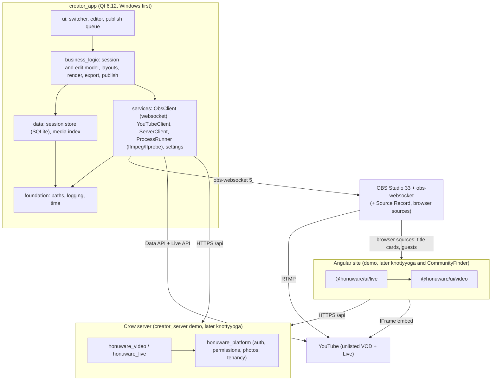

# Overview

Go into plan mode and use this document for your planning. Don't ask for permission to modify it or work in .claude/plans. This is your plan file. Please leave this Overview alone and build the plan in the following sections.

Use [[C:\Users\mason\Documents\Obsidian\Knotty Yoga\Claude\Streaming Platform for Creators Business Plan.md]] for context.

I want to get actually implementing a video delivery platform. The other document has the business long term needs but I want a plan to start building out the implementation.

These are the things we need in phases
- Record and serve simple video
	- Capture video from a phone / camera
	- Serve video from sharing control
	- Choose a video playback solution like unlisted YouTube video initially
- Record and serve branded video
	- All features of previous section
	- Put title intro and closing video at start and end of video with transitions
- Record and serve edited video
	- All features of previous section
	- Be able to cut and rearrange sections of the video
	- Be able to splice in other video
	- Be able to do voice overs over sections of video
	- Be able to put text and overlay graphics over sections of video
- Be able to change playback speed
	- All features of previous section
	- Be able to playback video at slower or faster than normal speed and do overlays, voice over, and other inputs while this video is at a different speed or fully paused 
- Record and serve multiple source video
	- All features of previous section
	- Have multiple cameras / video inputs
	- Have a set of layouts that you can go through and toggle between at various points
		- Each input being full screen
		- Side by side horizontally with two of the inputs
		- Side by side vertically with two of the inputs
		- One input full screen and the other a positionable PIP window
		- Four quadrants
		- One input full screen and multiple PIP
- Be able to stream video in real time
	- All features of previous section
		- For instance, you should be able to start the intro sequence while streaming, choose to play a video file, and be able to toggle between inputs (like two cameras or a video playback file)
	- In addition to streaming, all the inputs and decisions should be saved locally so that a fully edited video can be generated later
	- Have a control that can play the video in real time
- Have a good editing solution for previously streamed video
	- All features of previous section
	- For instance, we might use OBS studio for streaming but it might create a Davinci resolve solution (or something else or stay in OBS) for editing later
	- The saved input sources should be high quality
- Be able to put section titles in the video
	- All features of previous section
	- YouTube and other platforms have markers in the video for things like explanation here, breakdown of move, questions and answer, demo, etc.
- Allow interaction with viewers
	- All features of previous section
	- Have people be able to watch and click a button desiring to interact
	- Allow creator to see the people asking to interact and upgrade their connection
		- Upgrading the connection switches to a low latency connection to the video from the creator
		- It also sends a stream from the viewer being upgraded that becomes an input source to the creator so the creator can switch the viewer to full screen, PIP, etc.
		- We should allow multiple viewers to be upgraded
		- Should be able to also interactively downgrade back to normal viewer
		- The viewers audio should be mixed in as well
		- Record the video locally from the viewer

This is all of the phases. Please note that I would like this to largely be done in server components and web components. Eventually, these client playback controls will be used in knotty yoga and community finder but I think we should create a new repo that has the creator application that is probably a C++ native app for doing the capture of video and editing with a dummy webserver based on crow to host the server components pieces and the dummy website to host the web components playback / client recording control. I think we should have a phase to explore various solutions like OBS, davinci resolve, or even AI based video solutions at least for intro sequences and overlays. I'm leaning towards Youtube Unlisted videos initially but open to suggestions. I'm thinking the creator app will probably be a QT native C++ app that deep hosts OBS lib but we could start with early phases driving OBS through the socket API and do deep integration in a later phase. 

Let's start putting together the implementation plan but let's start with you offering a lot of ideas, doing research, and asking me questions.

Please create a plan with phases of implementation. Within each phase, please respect the layering of the system and start with the work in lower layers first. Please create checkboxes by work items and then check them off as you implement them. Within the subsections of each phase, please number each such subsection. Please stick to your internal tools to inspect the filesystem and avoid external tools like grep, sed, and awk that you need to prompt me to run. I will build the C++ server and run tests myself. I will also commit and push to GIT myself so please don't use GIT commands unless you really need to understand the history of the files. Please don't prompt me if you can and run prompt requests to completion. Please always add tests for anything you chance for which testing is possible. When building this plan, please create an open questions section for things you need to ask me instead of asking me questions at the prompt.

# Plan status

**v0.4 (10/29/2026): 0.1 is done, with findings, against your OBS 33.**
- **Results:**
  - Scene switching, layouts and chapter markers all work over the websocket.
  - The edit log's clock is settled (D-5): the app's own clock, from "recording started", is accurate to a frame. OBS's reported timecode lags by about 0.55 s.
- **Tests:** Windows: 105 passed. Linux: 105 passed.
- **Unchanged:** the Open Questions are still open.

**v0.3 (10/29/2026): `obs_probe` (0.1) written and tested (102 tests on each platform). Its findings waited on OBS's WebSocket server being turned on.**

**v0.2 (10/28/2026): first draft, for your review. Nothing is built yet.**

As the Overview asks, this draft starts with research, ideas and questions, then lays out the phases.
- **Phases 0 and 1** are detailed enough to start.
- **Phases 2–11** are sketched. Each gets its detail once the phase before it lands and Phase 0's findings are in.

**How to answer:** reply inline under each item in **Open Questions**. Every question has a default, and I'll use it if you don't answer.

**What I looked at:**
- **This document's inputs:** the business plan.
- **Your `video_library` Qt app:** its toolchain, its conventions, and the playback-speed crash it hit.
- **knottyyoga:** the home page's video section (`video-url.types.ts`).
- **honuware:** `server_components` and `@honuware/ui` 0.3.0.
- **CommunityFinder:** its repo layout.
- **This machine:** OBS 32.1.1 is installed, Qt 6.8.3 is in `C:\Qt`, the GPU is an RTX 3070 Ti, and DaVinci Resolve is not installed.

# Research findings (October 2026)

## What has changed since the business plan (April 2026)

| # | Finding | Why it matters here |
|---|---|---|
| R-1 | **OBS 33.0.0 shipped 10/23/2026.** • Requires Qt 6.10 or later (support for 6.4–6.9 was removed). • Built with VS 2026. • Dropped FFmpeg 6 and 7. • Overhauled plugin loading: third-party plugins move to a new folder, and the old locations work until 34.0. OBS 32.1 (March) added a new audio mixer, WebRTC simulcast, and partial canvas support in obs-websocket. | • The creator app should build on **Qt 6.12 LTS**, not video_library's 6.8.3, so the later libobs phase (Phase 10) shares OBS's Qt. • The third-party plugins this plan leans on (Source Record, Replay Source) need re-checking on 33. • You updated to 33.0.0 on 10/29. |
| R-2 | **obs-websocket 5.x, built into OBS since version 28, covers almost everything the early phases need.** It controls: • scenes, scene items and their transforms • inputs, filters and transitions • media inputs: play, pause, seek • recording: start, stop, pause, split • **`CreateRecordChapter`**: chapter markers; needs Hybrid MP4 and OBS 30.2 or later • streaming: start, stop, service settings • the virtual camera and the replay buffer It also sends an event for every state change. | • Confirms your instinct to drive OBS over the socket first. • Phases 1–9 can be built without linking OBS. • Section titles (Phase 8) are native. |
| R-3 | **OBS has no native per-source ("ISO") recording.** • The standard route is Exeldro's free *Source Record* filter plugin. Reviews mention past crashes. • OBS 31+ has *canvases* (multiple video mixes) in libobs. That's how a deep integration would record each input on its own. | • Recording every input at full quality (Phases 5–7) depends on a plugin until Phase 10. • Phase 0.2 tests the plugin on OBS 33. |
| R-4 | **DaVinci Resolve 21.1 (September 2026) removed scripting from the free edition.** • Python and Lua scripting are now Studio-only ($295, one-time). • Timeline import (File › Import › Timeline: OTIO, FCPXML, EDL) is a GUI action. | • "Generate a Resolve project automatically" needs Studio. • With free Resolve, our app writes an **OpenTimelineIO (OTIO)** file and you import it. Kdenlive and other editors open OTIO too. |
| R-5 | **YouTube Data API uploads are cheaper.** • Since 6/1/2026 quota is per bucket. `videos.insert` costs 1 unit from its own "Video Uploads" bucket, which defaults to 100 uploads a day. • Google's `videos.insert` page (read 10/28) now says uploads from *unverified* API projects are **not** restricted to private. That contradicts the 2020 rule that many guides still repeat. | • Automated unlisted uploads from the creator app look viable without Google's audit. • The sources disagree, so Phase 0.4 verifies it with a real upload before anything depends on it. |
| R-6 | **Google sign-in for a desktop app:** while the Google Cloud consent screen is in "Testing", its refresh tokens expire after 7 days. | • The creator app would make you sign in to YouTube every week unless the Google Cloud project is published. • A published but unverified project shows an "unverified app" warning until Google verifies it. • Phase 0.4 picks one. |
| R-7 | **YouTube basics:** • **Branding:** embeds can't be de-branded. `modestbranding` and `showinfo` no longer work, as knottyyoga's `video-url.types.ts` already records. • **Speed:** `setPlaybackRate` works in the IFrame API. • **Live API:** creates unlisted, embeddable broadcasts. • **First stream:** a channel's first live stream needs about 24 hours of enablement plus phone verification. | • Viewer-side speed control (Phase 4) comes free with YouTube. • Enable live streaming during Phase 0 so it doesn't block Phase 6. |
| R-8 | **Hosting prices** (third-party summaries; verify before buying): • **Bunny Stream:** about $0.01/GB a month to store, plus about $0.005–0.01/GB delivered in North America and Europe. • **Cloudflare Stream:** $5 per 1,000 minutes stored and $1 per 1,000 minutes delivered. • **Mux:** includes a free delivery allowance. • **AWS:** you already run **S3 + CloudFront** for knottyyoga, and CloudFront's always-free tier covers 1 TB a month of delivery. | • YouTube stays the Phase 1 host, as the business plan decided. • The cheapest upgrade that gives real access control (rather than "anyone with the link") is probably HLS on your existing S3 + CloudFront with signed cookies. |
| R-9 | **Interactive video options have matured:** • **VDO.Ninja:** free, open source, peer-to-peer. A guest becomes an OBS browser source. It documents mix-minus (each person hears everyone except themselves), and you can self-host its handshake server. • **LiveKit:** an open-source SFU (a server that forwards each participant's stream to the others), self-hosted or cloud. **Its egress records each participant separately without transcoding.** • **MediaMTX:** one binary. It takes WHIP ingest from OBS and serves WHEP to viewers who need under a second of latency, and LL-HLS to large audiences. • **OBS:** has had native WHIP *output* since version 30. Only third-party sites claim a native WHEP *input*. | • Phase 9 has three credible stacks. • VDO.Ninja is the fastest to prototype. • LiveKit fits "several upgraded viewers, each recorded". |
| R-10 | **Riverside and StreamYard record each guest *in the guest's browser* at full quality and upload as they go.** StreamYard lets a guest finish an interrupted upload within 30 days. | • That is exactly your "record the video locally from the viewer". • The design is the browser's MediaRecorder plus a resumable chunked upload, built as a web component. |
| R-11 | **Generating intros:** • **Remotion** (React) is free only for companies of 3 or fewer people. Above that it starts at $25 per seat per month. • **Motion Canvas** is MIT-licensed. • **AI video** is strong for backgrounds and B-roll but still unreliable for exact text and logos. Current options: Veo 3.1, Kling 4.0 (released 10/15/2026), Runway Gen-4.5, and the open-weight Wan 3.0. | Recommendation: render brand text and logos with a template, and use AI only for background loops. |
| R-12 | **Qt 6.12 LTS was released 9/30/2026** and is supported to 2031. • Since Qt 6.10 the Windows Media Foundation backend is deprecated, and FFmpeg is the default. • video_library had to work around an FFmpeg-backend crash when the playback rate changed. | • The editor's preview player can't rely on QMediaPlayer for variable speed. • Candidates: OBS's own media source, or **libmpv** (speed changes with pitch correction). • Phase 0.8 decides. |
| R-13 | **Hardware switchers already do "edit later".** Blackmagic's ATEM Mini Pro ISO and Extreme ISO record every input, plus a DaVinci Resolve project that contains the live cuts. | • Proves the "live decisions are just the default edit" model works. • A buy-instead-of-build fallback for multi-camera if the software path disappoints. |

## Tools surveyed, by job

- **Capture and switching:**
  - OBS (chosen).
  - vMix: Windows, paid; remote guests, instant replay, multiple recorders.
  - Ecamm: Mac only.
  - StreamYard and Restream Studio: browser-based, multiple guests, with layouts. These are the closest products to Phase 9.
  - Blackmagic ATEM ISO hardware.
- **Phone as a camera:**
  - The phone's own camera app, then file import: simplest, best quality.
  - Camo, DroidCam, Iriun: the phone becomes a webcam.
  - Windows 11 Phone Link: an Android phone becomes a webcam.
  - The NDI HX Camera app with the DistroAV plugin (formerly obs-ndi).
  - A phone browser page streaming over WebRTC: our own web component (see I-4).
- **Editing:**
  - DaVinci Resolve: since 21.1 the free edition only imports timelines through the GUI.
  - Kdenlive: open source, reads OTIO.
  - Descript: edit by editing the transcript; Studio Sound cleans up audio.
  - CapCut desktop: templates.
  - Shotcut, built on the MLT engine.
  - **Engines:** FFmpeg filter graphs, MLT, GStreamer Editing Services.
  - **Interchange formats:** OTIO, FCPXML, EDL.
- **Intros and overlays:**
  - OBS stinger transitions, text sources and browser sources.
  - FFmpeg `drawtext` and `xfade`.
  - Remotion, Motion Canvas, Lottie.
  - AI video: Veo, Kling, Runway, Wan.
- **Speed and replay:**
  - OBS media source: its `speed_percent` setting, plus play, pause and seek.
  - Exeldro's *Replay Source*: instant replay at a chosen speed, with frame stepping; users report stability problems.
  - Exeldro's *Freeze* filter.
  - FFmpeg `setpts`, `atempo` and `tpad` for speed changes and freeze frames in rendered video.
- **Real-time:**
  - VDO.Ninja, LiveKit, MediaMTX, Broadcast Box.
  - Cloudflare Stream WebRTC (WHIP/WHEP).
  - coturn: a TURN relay, needed when two browsers can't connect directly.
  - libdatachannel: C++17, LGPL; for the Phase 10 native path.
- **Hosting:**
  - YouTube unlisted: decided for the MVP.
  - Bunny Stream, Cloudflare Stream, Mux.
  - S3 + CloudFront HLS.
- **Speech:**
  - whisper.cpp (MIT, C++): transcripts, captions and suggested chapters.
  - OBS `SendStreamCaption`: live captions.

# Ideas

Each idea notes where it lands in the plan. Ideas marked *parked* aren't in any phase yet; say if you want one.

1. **I-1: The session folder and its edit log are the product's spine.**
   - **The folder:** every recording or stream is a folder that follows video_library's portability rules: one `session.json`, relative paths only.
   - **The log:** the creator app logs every live decision, stamped with OBS's record timecode: layout switches, input swaps, PIP moves, media play/pause/speed, overlays on and off, chapters.
   - **The log is an edit:** rendering it reproduces the live program, and re-editing it means changing your mind with hindsight.
   - **One model, four outputs:** it feeds the FFmpeg renderer, the OTIO export to Resolve, the YouTube chapters, and the web player's chapter list.
   - **Where:** Phase 3 defines it; Phases 4–9 add event types.
2. **I-2: One layout model, three renderers.**
   - **Layouts are data:** named slots with normalized rectangles.
   - **Three renderers from one definition:** OBS scenes over the socket (live), FFmpeg `overlay` graphs (offline render), and OTIO transforms (Resolve).
   - **Your six layouts** are just six shipped definitions, and custom ones come free.
   - **Where:** Phase 5.
3. **I-3: Graphics are web pages.**
   - **What:** title cards, lower thirds, section titles and callouts are `@honuware/ui` components on a chromeless page.
   - **Live:** OBS shows them as a **browser source** with a transparent background.
   - **Edited video:** the same page renders offline, frame by frame.
   - **Web player:** can overlay them too.
   - **Branding:** they use the theme tokens and fonts that already exist for whitelabeling, so branding is per-site data rather than per-video work.
   - **Where:** Phases 2, 3 and 8.
4. **I-4: A phone camera is just a guest who happens to be the creator.**
   - **Reuse:** the Phase 9 guest capture component already does camera checks, WebRTC sending, full-quality local recording and resumable upload. The same component turns any phone into a wireless camera in Phase 5.
   - **Build once, use twice.**
   - **Where:** Phase 5 if pulled forward (OQ-13); otherwise Phase 9.
5. **I-5: Mix-minus by construction.**
   - **The rule:** an upgraded viewer must not hear themselves.
   - **How:** guests receive *video* from the OBS program, muted, and *audio* as separate SFU tracks (the creator's mic plus the other guests).
   - **Result:** nobody hears themselves, and no audio routing is set up by hand.
   - **Where:** Phase 9.
6. **I-6: The server never sees raw footage.**
   - **Where footage lives:** ISO recordings stay on the creator's PC or NAS, and rendering happens on the creator's machine.
   - **What the server holds:** the catalog, access rules, chapters and published renders.
   - **Why:** hosting stays cheap and uploads stay small.
   - **The exception:** guest recordings in Phase 9 are uploaded, then pulled into the session folder.
   - **Where:** an architecture rule.
7. **I-7: Permissions are the currency of access, again.**
   - **What:** video visibility reuses honuware permissions, as in your permission-based class access. A video declares which permissions may watch it, and knottyyoga memberships grant those permissions.
   - **Plus:** expiring share links.
   - **Where:** Phase 1.
8. **I-8: The player doesn't care who hosts the video.**
   - **What:** `hw-video-player` takes a playback descriptor resolved by the server (a YouTube id, a file URL or an HLS URL), never a raw URL. `parseVideoUrl` already follows this safety rule.
   - **Why:** moving from YouTube to Bunny or S3 + CloudFront changes database rows, not pages. That is the business plan's migration path.
   - **Where:** Phase 1.
9. **I-9: Practice-mode playback.**
   - **What:** speed presets, looping a chapter, and mirroring (from the business plan's mobile section).
   - **Why:** cheap in the web player, and high value for follow-along movement content.
   - **Where:** Phases 4 and 8.
10. **I-10: Run-of-show cues.**
    - **What:** a live session is a cue list (intro → camera layout → play a clip → Q&A → outro).
    - **Driven by:** one big "Next" button, a phone remote page, or a foot pedal or Stream Deck. Useful when you're upside down on a rope.
    - **Where:** Phase 6.
11. **I-11: Sync slate.**
    - **What:** a flash and beep at the start of a session; the intro can include it.
    - **Why:** lining up external recordings (phone files, GoPro, guest recordings) automatically becomes a solved audio-matching problem.
    - **Where:** Phase 5.
12. **I-12: whisper.cpp transcripts.**
    - **What:** captions, searchable transcripts, and *suggested* chapters you accept or edit.
    - **Where:** Phase 8 (stretch).
13. **I-13: Telestration in slow motion.**
    - **What:** draw arrows on a paused or slowed frame while narrating, sports-analysis style.
    - **Where:** Phase 4.
14. **I-14 (parked): Smart camera switching.** Pose detection (MediaPipe) suggests which angle to cut to.
15. **I-15 (parked): Highlight and clip generation** for Reels and Shorts, from chapters and the transcript.
16. **I-16: Self-host the broadcast later.**
    - **What:** OBS → MediaMTX → LL-HLS for everyone, with WHEP for upgraded viewers.
    - **Why:** one upload from the studio, a real paywall, and no YouTube branding.
    - **Where:** OQ-17, after Phase 9.

# Proposed architecture

## Where code lands

| Place | What | Notes |
|---|---|---|
| **New repo `creator_studio`** (name: OQ-1), at `C:\Users\mason\source\repos\creator_studio` | • `creator_app/`: the Qt 6.12 C++ desktop app • `server/creator_server/`: a Crow demo server that consumes honuware • `ui/`: an Angular demo site that consumes `@honuware/ui` • `shared/fixtures/`: JSON fixtures that both the C++ and TypeScript tests read | • Mirrors CommunityFinder's `server/` + `ui/` layout. • The creator app copies video_library's toolchain: setup script, Conan, `windeployqt`, layer rules, GoogleTest runner. |
| **`server_components`** (honuware) | • New layer **`honuware_video`** above `honuware_platform`: catalog, access, playback, chapters, templates, uploads. • Later, **`honuware_live`**: live sessions, the raise-hand queue, guest tokens, signaling. | Built with the `FETCHCONTENT_SOURCE_DIR_HONUWARE` co-dev override, then pushed and re-pinned at each phase's bump point, as with the tenancy work. |
| **`honuware-web-components`** (`@honuware/ui`) | • New entry point **`video`**: player, chapters, share dialog, title-card and overlay components, chunked uploader. • Later, **`live`**: live player, raise hand, guest stage, local recorder, host queue. | • **Layering:** `video` sits on `foundation` + `access`; `live` sits on `video` + `auth`. • **Access seams:** new `VideoAccess` and `LiveAccess`, each with an `HONUWARE_*_ACCESS` token and HTTP and mock implementations, like `CrudAccess`. |
| **knottyyoga and CommunityFinder** | Consume `@honuware/ui/video` and `honuware_video` in Phase 11. | knottyyoga's `video-url.types.ts` moves into the library in Phase 1. knottyyoga keeps working unchanged until it adopts the library. |

## Layering

Rules:
- **Siblings:** in the Qt app, `services` and `data` are siblings and neither includes the other, as in video_library.
- **No OBS in honuware:** nothing in `honuware_video` knows about OBS or Qt.
- **Shared fixtures:** the layout, edit and chapter JSON shapes are pinned by files in `shared/fixtures/`. Both the C++ and the TypeScript tests load them, so the two sides can't drift.

## Data model sketch (server, `honuware_video`)

| Table | Purpose | Phase |
|---|---|---|
| `videos` | Title, description, owner, status (`draft`/`ready`/`archived`), visibility (`private`, `link`, `signed_in`, `permission`, `public`), duration, poster photo (the existing photos table), timestamps | 1 |
| `video_sources` | Provider (`youtube`/`file`/`hls`/…), external id or URL, MIME type, primary flag. A video can have several, so a host migration only adds rows. | 1 |
| `video_access_permissions` | (video, permission): who may watch when visibility is `permission` | 1 |
| `video_share_links` | Hashed token, expiry, revoked flag, creator. Modeled on password-reset tokens. | 1 |
| `video_templates` | Brand templates for intros, outros and lower thirds: kind, component name, default parameters (JSON), assets | 2 |
| `video_chapters`, `chapter_kinds` | Start time, title, kind (explanation, breakdown, Q&A, demo…), icon | 8 |
| `live_sessions`, `live_participants`, `live_hand_raises` | Status (scheduled, live or ended), broadcast id; each viewer's path: viewer → requested → upgraded → downgraded | 6, 9 |
| `upload_sessions`, `upload_chunks` | Resumable chunked uploads (guest recordings, self-hosted files) | 9 (earlier if self-hosting) |

Crow reads each request body fully into memory. Large files therefore arrive as chunks of a few MB, each its own request, and are reassembled on disk. In production they can instead go straight to S3 through presigned multipart URLs.

# Implementation plan

**Tags:**

| Tag | Meaning |
|---|---|
| **[hw]** | honuware `server_components` |
| **[hw-ui]** | `@honuware/ui` |
| **[srv]** | the creator_studio demo server |
| **[web]** | the creator_studio demo site |
| **[app]** | the Qt creator app |
| **[Mason]** | needs you: hardware, accounts, installs, git |

**Order inside each phase, lowest layer first:**
1. **[hw]:** schema → table helpers → business logic → endpoints.
2. **[hw-ui]:** access seam → components.
3. **[srv] and [web]:** wiring.
4. **[app]:** services → data → business logic → UI.

**Tests:** every code item ships with tests. That means GoogleTest without fixtures, Karma specs, and ServerAccess-style mocks.

**Detail level:** Phases 0–1 are ready to execute. Phases 2–11 give the shape, and each gets its detail (and its open questions settled) when the phase before it lands.

## Phase 0 — Explore and decide

Goal: answer the questions that would be expensive to get wrong, using small throwaway probes rather than production code. Each item ends with a short findings note under **Decisions**.

### 0.1 OBS control probe
- [x] [Mason] Update OBS from 32.1.1 to 33.0.0. Turn on the WebSocket server (Tools › WebSocket Server Settings) and note the password. ✅ 2026-10-29
  - *Checked 10/29: OBS 33.0.0 is installed and running, but the WebSocket server is still **off**. Its settings file has `server_enabled: false` and nothing is listening on port 4455, so `obs_probe` stops with "cannot talk to OBS". A password is already saved, so the probe picks it up and you don't need to note it.*
- [x] [app] Write `obs_probe`, a small Qt console program in `creator_studio/tools/` built on Qt WebSockets. It will:
  - sign in to OBS's websocket (obs-websocket 5 uses a SHA-256 challenge)
  - list scenes and inputs
  - create a scene with two sources and move one into a picture-in-picture rectangle
  - switch the program scene
  - start and stop a Hybrid MP4 recording, and add a chapter marker
  - print every event with its record timecode
  - *Done 10/29: `creator_studio/tools/obs_probe`, on Qt 6.12.0. Windows: 102 passed. Linux: 102 passed (Debian trixie, Qt 6.8.2). The README has the details.*
    - **Three modes:**
      - `list` is read-only.
      - `run` is the probe.
      - `watch` prints every event, stamped with the record timecode while recording.
    - **Beyond the spec, so the findings mean more:**
      - **Two layouts from one input:** a PIP layout and a full-screen layout, so the layout model (I-2) gets exercised.
      - **Timed switches:** several switches during the recording, each timed to the response and to the `CurrentProgramSceneChanged` event.
      - **Timecode sampling:** `GetRecordStatus` every 250 ms, to measure the timecode-to-wall-clock offset and drift.
      - **PIP check:** the PIP rectangle is read back to check where OBS actually put it.
    - **Safe to run on your real OBS:**
      - It refuses while you're streaming or recording.
      - Every change is paired with its undo, and the undos run at the end or on any failure: stop the recording, restore the program scene, remove its inputs and scenes, restore the recording format.
      - It also removes anything an interrupted earlier run left behind. All of it is named `obs_probe …`.
      - The only thing it leaves is the short recording, whose path it prints.
    - **The password stays out of sight:** it's read from OBS's own settings file and never typed or printed. `OBS_WEBSOCKET_PASSWORD` overrides it.
    - **Built to move into the creator app** as its `ObsClient`:
      - the protocol, as pure functions
      - the client
      - `FakeObsServer`, a stateful stand-in for OBS that every test runs against
    - **The Windows tests caught a Qt bug:** for a refused connection, Qt 6.12 on Windows signals "disconnected" before the error. The message now says to turn on the WebSocket server, rather than "normal close".
- [x] [Mason] Turn the WebSocket server on (Tools › WebSocket Server Settings › Enable WebSocket server › OK), then tell me. I run `obs_probe list`, then `obs_probe run`, and fill in the findings below. ✅ 2026-10-29
  - **What the run touches:** it adds two temporary scenes, briefly switches your program scene, and records about 8 seconds.
  - **Running it yourself:** `out\build\x64-Debug\bin\obs_probe.exe run` from the probe's folder, then paste the output here.
  - *Done 10/29. There were two runs: the default 8 s, then `--record-seconds 30 --switches 10`. Both finished with exit code 0 and put OBS back exactly (scene "Scene", recording format `hybrid_mp4`, which was already set). Each recording was checked frame by frame with ffprobe and ffmpeg.*
  - *The first run's output was misleading in two places: it extrapolated the record clock from OBS's lagging timecode, and it compared width/height where the bounds are what count. Both are fixed, along with a new timing for `SceneTransitionStarted`. The tests went from 102 to 105. Windows: 105 passed. Linux: 105 passed.*
  - *The two test recordings are in `C:\Users\mason\Videos`: `2026-10-29 15-27-10.mp4` (8 s) and `2026-10-29 15-33-19.mp4` (30 s). Open one in VLC (Playback › Chapter) to see the markers, then delete them.*
- [x] Findings (OBS 33.0.0, obs-websocket 5.7.6, Simple output mode, NVENC, 1920x1080 canvas, 1280x720 output at 30 fps, Fade 300 ms): ✅ 2026-10-29
  - how long a scene switch takes
    - **The request is fast:** the response takes about 6 ms (3.7–35 ms).
    - **`SceneTransitionStarted` comes first:** it arrives within 1 ms, before the response. In the file, every fade starts within one frame of that event.
    - **`CurrentProgramSceneChanged` comes last:** it arrives only when the transition finishes, about 330 ms with the 300 ms Fade.
    - **So:** the edit log stamps a switch at `SceneTransitionStarted`, or at the moment it sends the request, and records the transition's kind and length. Stamping at `CurrentProgramSceneChanged` would put every cut a transition's length late.
  - whether `CreateRecordChapter` works on OBS 33
    - **Yes, with Hybrid MP4.** Both markers in both runs landed in the file within one frame of their request (1.000 s became 0.966 s; 10.306 s became 10.300 s).
    - **OBS adds two chapters of its own:** a "Start" chapter at 0:00, and a trailing "Dummy" chapter that starts at the end of the video and runs past it (30.0 s to 49.7 s).
    - **So:** YouTube chapters (Phase 8) come from our own log, not from the file's chapter list.
  - how the record timecode relates to the wall clock (the edit log depends on this)
    - **The probe's own clock is accurate.** Wall time since the "recording started" event (`RecordStateChanged` STARTED) matches the file to within one frame:
      - all 10 fades
      - both chapters
      - the file's length: 900 of 900 frames, exactly 30.000 s against 30.0 s of wall time
    - **OBS's reported timecode is not.** `GetRecordStatus` (`outputTimecode` and `outputDuration`) counts frames that have come *out of the encoder*. It sits near 0 for the first ~0.6 s, then lags the file by a steady ~0.55 s (range 528–571 ms, changing by only 20 ms over 29 s).
    - **So (D-5):** the edit log stamps decisions with the creator app's own monotonic clock, measured from the STARTED event, and uses `GetRecordStatus` only to confirm the recording is running.
    - **Still open: drift over a full session.** None appeared over 30 s, but an hour-long session needs checking. Do that during 0.2's 10-minute recording, with `obs_probe watch` running alongside.
  - **Also found:**
    - **Duplicate events:** OBS 33 sends `SceneCreated` **twice** for every new scene, so anything that consumes events must tolerate duplicates.
    - **Bounds:** the PIP lands exactly where asked (checked on a frame of the recording). `GetSceneItemTransform`'s `width`/`height` ignore the bounds, so compare `boundsWidth`/`boundsHeight` instead.
    - **One input, many layouts:** one input in two scenes with two transforms works. That's the layout model (I-2) in miniature.

### 0.2 Multi-source capture probe

**Camera recommendation (10/29/2026, from your question: matching cameras, not a lot of money).** Prices are from listings checked 10/29, so verify them at checkout.

**How each camera connects:**

| Connection | Use it when | Pros | Cons |
|---|---|---|---|
| **USB-C (UVC webcam)** | The cameras can sit within ~5 m of the PC, or ~10 m with an active USB 3 cable or a USB-C fiber cable (~$30–80; check it's rated for 5 Gbps). | • **Cheapest.** • **Lowest latency:** a frame or two, so no audio delay to set. • **One cable:** power and video. • **Full control:** exposure and white balance from the app, and later from the creator app through the camera's SDK. | • **Cable length.** • **USB ports:** each camera wants its own USB 3 port. Several identical webcams can get mixed up in OBS on Windows. The usual fix is to put each camera on a different port or controller and keep it there. |
| **Ethernet (NDI HX, PoE)** | A permanent installation with cameras far from the PC (ceiling corners, the far wall). | • **One cable:** power, video and control, up to 100 m through a PoE switch. • **Saved camera positions** (PTZ presets). • **Scales** to many cameras. | • **About 2–3× the price** per camera. • **About 100–150 ms of latency:** set a matching audio delay in OBS. • **Compressed video.** • **Needs the DistroAV plugin** (6.2.2 is "OBS 33+ ready") and the NDI runtime. |
| **Wireless (Wi-Fi NDI, phone apps, wireless HDMI)** | Only for a roaming or temporary angle. | • **No cables.** | • **Unpredictable:** latency varies, and the picture can drop out. • **Batteries.** • **Interference** in a busy room. • **Not suitable for the main angles.** • The phone already covers this role (0.3, I-4). |

**Recommendation:**
- **Buy:** two identical **OBSBOT Tiny 3 Lite** USB-C webcams. They list at $199 and were $169 on sale in June.
- **Total:** about **$400–520**, including two 10 m active USB 3 cables if the PC is far from where the cameras go.
- **Third angle:** your phone, as the plan already has it.
- **Why this camera:**
  - **AI tracking on a motorized mount:** it pans and tilts to follow you, which matters for inversions and rope work that a fixed wide shot would crop.
  - **4K:** room to crop and reframe in the edit, even though the stream goes out at 720p or 1080p.
  - **Manual exposure and white balance:** you can set both cameras the same, so they match.
  - **An SDK:** the creator app can push identical settings to every camera.
  - **Current model:** this year's model is still for sale, so a matching third camera will be available later. A cheaper previous-generation model may not be.
- **If the studio light is dim:** spend $150 more per camera on the **Tiny 3**, which has a much larger 1/1.28" sensor (the Lite's is 1/2"). The same advice applies to both: buy the same model throughout.
- **Making the angles match:**
  - Lock each camera to manual white balance at the same Kelvin value.
  - Lock exposure (shutter and ISO).
  - Turn off HDR and auto-framing exposure.
  - Save the same profile in OBSBOT Center.
  - Identical cameras still won't match if light from windows changes during a class. Steady LED studio lighting is the real fix, and can come later.
- **Where to buy:** a shop with a 30-day return window, so 0.2 runs before it closes.
- **Not recommended at this budget:**
  - **Mirrorless cameras plus capture cards:** they look the best, but the cheapest suitable body (Sony ZV-E10 II) is about $1,000–1,200, and reviews report overheating in long 4K sessions.
  - **NDI PTZ cameras:** consider them if you later want a ceiling-mounted permanent installation. Options:
    - AVKANS LV20N, about $430
    - SMTAV 4K NDI, about $650
    - OBSBOT Tail Air, about $600 with NDI, plus a $99 Ethernet/PoE adapter
    - OBSBOT Tail 2, about $1,300, with built-in PoE

- [ ] [Mason] Inventory the cameras, capture cards, phones and microphones you'd actually use (OQ-11). If buying, the default is two OBSBOT Tiny 3 Lite cameras (see above).
- [ ] [Mason] Install *Source Record* on OBS 33, in the new plugin folder.
- [ ] [Mason] Record two cameras and one phone (as a webcam) for 10 minutes, with a separate ISO file per source.
- [ ] Findings:
  - GPU and CPU load on the 3070 Ti, using NVENC for H.264/HEVC (30-series cards can't encode AV1)
  - whether the ISO files start at the same moment
  - disk use per hour
  - any crashes
  - whether the record clock (D-5) drifts over 10 minutes. Run `obs_probe watch` alongside the recording, then compare its stamps for a few scene switches with the file.
  - whether two identical USB cameras keep their identities in OBS after unplugging and rebooting
  - whether the cameras are best run at 1080p60 or 4K30 (USB bandwidth and decode load against room to crop)
  - how many NVENC sessions the run uses: one ISO per camera, plus the program recording, plus a stream. Recent drivers allow 8 at once on GeForce cards; confirm that on this driver.

### 0.3 Phone capture probe
- [ ] Compare four routes on quality, latency and fuss:
  - the phone's camera app, then file import
  - Camo, DroidCam or Iriun
  - NDI HX Camera with DistroAV
  - VDO.Ninja in the phone's browser, standing in for our future web component
- [ ] Findings:
  - the Phase 1 capture route (default: native camera, then import)
  - the Phase 5 route for a phone as a live camera

### 0.4 YouTube probe
- [ ] [Mason] Pick the channel or channels (OQ-7).
- [ ] [Mason] Create a Google Cloud project, turn on YouTube Data API v3, and create a *Desktop app* OAuth client.
- [ ] [app] Write `youtube_probe`. It will:
  - sign in through a loopback redirect (Qt NetworkAuth)
  - upload a short clip as **unlisted**, with a resumable upload
  - set a title, and a description containing chapter timestamps
  - read the video back
- [ ] Verify R-5: does an upload from an unaudited project stay unlisted, or is it forced to private?
- [ ] Verify R-6: how long tokens last in Testing compared with a published project.
- [ ] [Mason] Turn on live streaming for the channel now (a 24-hour wait plus phone verification), so it can't block Phase 6.
- [ ] Embed checks on a test page:
  - an unlisted video in a youtube-nocookie iframe
  - `setPlaybackRate`
  - whether chapters show in the embedded player

### 0.5 Editing hand-off probe
- [ ] [Mason] Install DaVinci Resolve 21.1 (free).
- [ ] [app] Write `otio_probe`. It writes an `.otio` timeline from 0.2's two ISO files plus a hand-written switch log containing:
  - cuts between angles
  - one PIP segment
  - chapter markers
- [ ] Import the timeline into free Resolve (File › Import › Timeline) and into Kdenlive. Note what survives: cuts, transforms, markers, audio tracks.
- [ ] Findings:
  - whether free Resolve + OTIO is good enough for Phase 7, or whether Studio ($295) is worth buying (OQ-15)
  - whether free Resolve decodes the ISO files from 0.2 (10-bit and 4:2:2 HEVC are known Studio-only areas)

### 0.6 Intro/outro probe
- [ ] Build one title card three ways:
  - an HTML/CSS page shown in an OBS browser source (I-3)
  - FFmpeg `drawtext` and `xfade`
  - an AI-generated 6-second background loop with the text laid over it by a template
- [ ] Findings: compare the look, the effort and how brandable each is, then pick the Phase 2 approach (OQ-14).

### 0.7 Interaction probe
- [ ] **VDO.Ninja:** bring one remote guest into OBS as a browser source. Check mix-minus, round-trip latency and quality.
- [ ] **LiveKit:** run a room with two guests, on the LiveKit Cloud free tier or the server binary on a scratch machine. Record each participant with track egress.
- [ ] **MediaMTX:** send OBS over WHIP into MediaMTX, then play it over WHEP in a browser. Compare the latency with YouTube Live's ultra-low setting.
- [ ] Findings: the Phase 9 stack (OQ-16), and whether YouTube stays the broadcast layer (OQ-17).

### 0.8 Variable-speed probe
- [ ] **OBS media source:**
  - play at 25%, 50% and 200% using `speed_percent`
  - pause and resume over the socket
  - hold a freeze frame
  - record narration live over it
- [ ] **Replay Source on OBS 33:** an instant replay of a camera at half speed.
- [ ] **Editor preview player:** compare QMediaPlayer (FFmpeg backend) with libmpv, both from 0.25× to 2× with audio. Keep video_library's swresample crash in mind.
- [ ] Findings: the Phase 4 approach.

### 0.9 Decision record
- [ ] Fill in **Decisions** from 0.1–0.8, and settle the open questions they answer.
- [ ] Then add detail to Phase 1's remaining items.

## Phase 1 — Record and serve simple video

**Goal:** record on a phone or camera and publish to YouTube as unlisted. Register the video in the catalog with access rules, and watch it on the demo site through the new player. The server enforces who can watch.

**A fallback that works on day one, with no app:** record on the phone, upload as unlisted from the YouTube app, and paste the link into the demo site.

### 1.1 Repository scaffold
- [ ] [Mason] Create `honuware/creator_studio` on GitHub (private), per OQ-1.
  - *The local folder `C:\Users\mason\source\repos\creator_studio` exists since 0.1, holding `tools/obs_probe` plus the top-level `CLAUDE.md`, `.gitignore` and `.gitattributes`. It isn't a git repository yet; `git init` there, or clone the new repo and move the files in.*
- [ ] [app] Create the `creator_app/` skeleton, copied from video_library's working toolchain:
  - `tools/setup_machine.ps1`, installing **Qt 6.12** through aqtinstall with Multimedia, NetworkAuth, WebSockets and WebEngine
    - *Found in 0.1: aqtinstall 3.3.0 (the newest on PyPI, as of 10/29) can't install Qt 6.12. Qt's repository now has one folder per architecture (`qt6_6120/qt6_6120_msvc2022_64/`). For the probe, I downloaded `qtbase` and `qtwebsockets` from there by hand, checked their SHA-1s, and unpacked them into `C:\Qt\6.12.0\msvc2022_64`. Until aqt catches up, the setup script has to do the same for each module. `Qt6_ROOT` stays on 6.8 for video_library; creator_studio's presets set it as a CMake cache variable instead (D-4).*
  - the Conan provider
  - `windeployqt` after each build
  - targets `creator_core`, `creator_app` and `creator_tests`
  - logging and settings
  - a test main that turns on `QStandardPaths` test mode
- [ ] [srv] Create `server/creator_server/` from CommunityFinder's template: a Crow app that consumes honuware at a pinned SHA, with its own database name, a database helper exe, a test exe and a Linux docker gate.
- [ ] [web] Create `ui/`, an Angular app on the current Angular major version.
  - Login, register and admin come from `@honuware/ui`.
  - It uses the documented sibling-checkout co-dev.
- [ ] [all] Add `CLAUDE.md`, `README.md`, `.gitignore` and `shared/fixtures/`, and record the planning-document rule.
  - *Started in 0.1: `CLAUDE.md` (with the planning-document rule, who does what, and the conventions), `.gitignore` and `.gitattributes` exist. The top-level `README.md` and `shared/fixtures/` are still to do.*

### 1.2 [hw] Schema
- [ ] Create `videos`, `video_sources`, `video_access_permissions` and `video_share_links` in a new `components/video/db_schema/`, with a header and a cpp for each.
  - Apps opt in through a `MakeVideoTables` function.
- [ ] Seed a `manage_videos` permission alongside the framework permissions.
- [ ] Add a `PopulateVideoAdminMetadata` helper, so each consuming app's database helper registers the tables for admin in one call.
  - It covers top-level and nested tables, column data info, friendly names and display templates.
  - Follow the "Adding a New Database Table" checklist, step 4 included.
- [ ] Add framework migrations for the four tables. They must be safe to run twice.
- [ ] Create a `honuware_video` CMake target above `honuware_platform`, and update the layering validation.
- [ ] Tests:
  - schema tests that read through the production readers
  - running the migrations twice changes nothing

### 1.3 [hw] Table helpers
- [ ] Create `TableHelpers::Videos`, `VideoSources`, `VideoAccessPermissions` and `VideoShareLinks` on the DbCrud helpers.
- [ ] Tests: create/read/update/delete round trips, with no assumed order.

### 1.4 [hw] Business logic, in `business_logic/video/`
- [ ] `VideoAccessPolicy::CanView(viewer, video)` decides from visibility and permissions.
  - It has a **seam for effective permissions**, so an app can add permissions granted by memberships.
  - knottyyoga's `CatalogHelper::GetEffectivePermissionIds` plugs in later.
- [ ] `PlaybackResolver` turns a video into a `PlaybackDescriptor {kind, youtubeId | url, mimeType}`.
  - It validates YouTube ids and https file URLs on the server, porting `parseVideoUrl`'s rules, so nothing unvalidated reaches an iframe.
- [ ] `ShareLinkService` handles share links:
  - create: a random token, stored hashed
  - validate: checks expiry and revocation
  - revoke
- [ ] Add `VideoKeyValueTable` converters.
- [ ] Tests:
  - the full access matrix: anonymous, signed in, holding the permission, owner, and admin, against each visibility
  - share-link expiry and revocation
  - descriptor validation, including hostile URLs

### 1.5 [hw] Endpoints
- [ ] Reading:
  - `GET /api/videos`: videos the caller can see, paged like the existing paged lists
  - `GET /api/video/{id}`: metadata, plus the playback descriptor only when the caller is allowed. A private video returns 404 rather than 403, so ids can't be probed.
- [ ] Managing (requires `manage_videos`): `POST /api/video_create`, `/api/video_update`, `/api/video_delete` and `/api/video_set_access`.
- [ ] Share links: `POST /api/video_share_link_create` and `/api/video_share_link_revoke`, plus `GET /api/video_by_share/{token}`.
- [ ] Tests:
  - an endpoint test per route, including permission failures
  - CSRF, and GETs while signed out

### 1.6 [hw-ui] The `@honuware/ui/video` entry point
- [ ] Add a `VideoAccess` seam with an `HONUWARE_VIDEO_ACCESS` token, an HTTP implementation, and a `MockVideoAccess` in `testing`.
- [ ] Move `parseVideoUrl` and `youtubeEmbedUrl` from knottyyoga into the library, with their spec.
- [ ] `hw-video-player` puts a YouTube adapter and an HTML5 adapter behind one interface.
  - The YouTube adapter uses the IFrame API on youtube-nocookie.
  - The interface covers play, pause, seek, rate and events, so later phases can add HLS without touching any page.
- [ ] Add these components:
  - `hw-video-list`
  - `hw-video-detail`: the watch page
  - `hw-video-share-dialog`: visibility, a permission picker built on the existing fk-picker, and share links
- [ ] Add ESLint boundary rules for the new entry point. Add specs for every component and for the mock.
- [ ] When the phase lands, release a new minor version of `@honuware/ui` (tag).

### 1.7 [srv] and [web] Demo wiring
- [ ] [srv] Compose `MakeVideoTables`, and seed a demo creator and a demo permission.
- [ ] [web] Add routes for the library, watching, watching by share link, and Manage (add from a YouTube link, edit, share).

### 1.8 [app] Import and publish
- [ ] **services:**
  - `ProcessRunner` and `ToolRegistry` for ffmpeg and ffprobe, from video_library
  - `YouTubeClient`: OAuth loopback sign-in, tokens stored in Windows Credential Manager, resumable upload
  - `ServerClient`: sign-in, CSRF and `video_create`, following the pattern in honuware's `scheduler/api_client.h`
- [ ] **data:**
  - a session folder holding `session.json` (I-1), with paths relative to the folder root
  - a local SQLite index of sessions and their publish state
- [ ] **business_logic:**
  - `ImportService`: copies from a phone, SD card or USB drive, then probes the file and makes a thumbnail
  - `PublishService`: uploads as unlisted, registers the video in the catalog with its visibility, and records the result. Failed uploads retry and resume.
- [ ] **ui:** a Sessions list, Import, and a Publish queue with progress.
- [ ] Tests:
  - the YouTube and server clients against a fake HTTP layer
  - the import and publish state machines
  - a session file round trip

### 1.9 Verification
- [ ] Hand test, starting from a blank database:
  1. Sign in to the demo site as the seeded creator.
  2. Use Manage › Add video to add one from a YouTube link.
  3. Restrict it to a permission.
  4. Check that a second account without the permission can't see it, and that an account with it can.
  5. Create a share link and open it while signed out.
  6. Repeat end to end for a video published from the creator app (Import, then Publish).
- [ ] ⇑ Bump point:
  - push honuware and re-pin creator_server
  - publish `@honuware/ui`
  - report the test counts

## Phase 2 — Record and serve branded video

Goal: every published video gets the studio's intro and outro, with transitions, without any per-video design work.

### 2.1 [hw] Templates
- [ ] Add `video_templates` with these fields:
  - kind: intro, outro or lower third
  - component name
  - default parameters
  - asset references into `site_assets`
- [ ] Add endpoints to list, get and manage templates, with tests.

### 2.2 [hw-ui] Title-card components (I-3)
- [ ] `hw-title-card`:
  - draws from a template plus parameters (title, instructor, level, duration) and the site's theme tokens and fonts
  - has a transparent-background mode for OBS
- [ ] **Deterministic clock:** the animation is a pure function of time `t`.
  - A page can be stepped frame by frame (`?t=`) for offline capture.
  - Live, it plays normally.
- [ ] A template editor with live preview in Manage, plus specs that check frames at fixed values of `t`.

### 2.3 [web] Chromeless card route
- [ ] `/card/:templateId` renders a single card from query-string parameters, with no site chrome. OBS browser sources and the offline renderer both use it.

### 2.4 [app] Brand render pipeline
- [ ] `TitleCardRenderer` captures a card to a clip, using the approach chosen in 0.6: frame capture in a headless browser, or recording an OBS scene.
- [ ] `RenderGraphBuilder` builds the FFmpeg command. It is a pure function, tested on its output strings.
  - video: intro → `xfade` → main → `xfade` → outro
  - audio: `acrossfade` between the parts, then `loudnorm`
- [ ] Publish runs the brand render before uploading, with a template chosen per session.
- [ ] Tests:
  - filter-graph strings
  - parameter substitution
  - the render job's state machine

## Phase 3 — Record and serve edited video

Goal: cut and rearrange, splice in other clips, add voice-over to sections, and add text and graphics. A guided editor, not a full editing suite (business plan decision 5).

### 3.1 [app] Edit model (I-1)
- [ ] A versioned JSON project file containing:
  - tracks: main video, overlays, voice-over, music
  - clips: session media with in and out points
  - overlay items: template, parameters, rectangle and time range
  - audio levels
- [ ] The project also needs validation, and migrations between schema versions.
- [ ] Shared fixtures in `shared/fixtures/edit/`, so later web previews read the same shape.

### 3.2 [app] Renderer and exports
- [ ] Render an edit model to an FFmpeg `filter_complex`:
  - trim and concatenate
  - overlays at their times
  - lower the music under voice-over with `sidechaincompress`
- [ ] Generate low-resolution proxies for editing.
- [ ] Export an edit model to OTIO, for finishing in Resolve or Kdenlive.
- [ ] Tests:
  - model operations: split, ripple delete, move, insert
  - render-graph strings
  - OTIO output against the fixtures

### 3.3 [hw] and [hw-ui] Overlay templates
- [ ] Add lower thirds, callouts and arrows as more `video_templates` kinds and `hw-*` components, all on the same deterministic clock.

### 3.4 [app] Editor UI
- [ ] Build the editor:
  - a timeline on QGraphicsView, as in video_library's player overlay
  - a preview, using the player chosen in 0.8
  - cut, split and drag
  - splice from the library
  - record voice-over over a selected range (Qt Multimedia audio input)
  - place overlays
- [ ] Undo and redo. Keyboard-first, like video_library's shortcut table.

## Phase 4 — Playback speed

Goal: viewers control playback speed. The creator can run footage slower, faster or paused, and keep narrating, drawing and adding overlays, both live and in the edit.

### 4.1 [hw-ui] Viewer side
- [ ] Add speed presets (0.25–2×), looping a range, and mirroring (I-9) to `hw-video-player`, for both adapters.

### 4.2 [app] Speed changes and freeze frames in the edit model
- [ ] Segments carry a speed factor or a hold (freeze frame).
  - Voice-over and overlays live on the *output* timeline.
  - So narration recorded at normal speed lines up with slowed footage.
- [ ] Renderer:
  - `setpts` with chained `atempo`. One `atempo` covers 0.5–100×, so slower speeds chain several.
  - `tpad` or a held frame for freezes.
- [ ] Tests on the timing math, converting output time to source time and back.

### 4.3 [app] Live analysis mode (I-13)
- [ ] An "analysis" scene with:
  - a replay or media source at a chosen speed
  - pause and frame-stepping over the socket
  - freeze frames
  - a layer for drawing on the video: an OBS drawing plugin or our own overlay page; 0.8 decides
  - the narration mic live
- [ ] Every action goes into the edit log, so the analysis segment can be re-edited later.

## Phase 5 — Record and serve multiple source video

### 5.1 [app] Layout model (I-2)
- [ ] Slots with normalized rectangles. These layouts ship built in:
  - each input full screen
  - two side by side (horizontal)
  - two stacked (vertical)
  - one full screen with a positionable PIP
  - four quadrants
  - one full screen with several PIPs
- [ ] Custom layouts are saved per creator, and the fixtures are shared with [hw-ui].
- [ ] Tests:
  - geometry for every shipped layout at 16:9 and 9:16
  - keeping a PIP inside the frame
  - swapping slots

### 5.2 [app] OBS scene generation and live switcher
- [ ] An input registry: cameras, capture cards, NDI sources, phones, media files.
- [ ] Generate one OBS scene per layout, with a nested scene per slot, so swapping a slot's input is one call.
- [ ] The switcher UI:
  - big layout buttons
  - an input picker for each slot
  - PIP dragging and corner presets
  - hotkeys
  - every action goes to the edit log with its timecode
- [ ] An ISO recording of every input (Source Record, per 0.2), plus a recording of the program.

### 5.3 [app] Multi-source edit
- [ ] The edit model gains layout segments over synchronized sources, so you can re-decide layouts after the fact. The renderer and the OTIO export handle them.
- [ ] Sync:
  - inputs captured by OBS share OBS's clock
  - external files are lined up by matching their audio (the sync slate, I-11)
  - a manual nudge as a fallback

### 5.4 Phone as a live camera (I-4, if pulled forward; OQ-13)
- [ ] The Phase 9 capture component, used in "creator camera" mode on the local network.

## Phase 6 — Stream video in real time

### 6.1 [hw] Live sessions
- [ ] Add `live_sessions` (title, schedule, status, the provider's broadcast id, visibility through the Phase 1 policy), with endpoints and tests.

### 6.2 [hw-ui] `@honuware/ui/live`: the live player
- [ ] `hw-live-player` follows the session, polling its status from the server:
  - **before:** a countdown
  - **during:** the live embed
  - **after:** switches to the recorded video
- [ ] Specs.

### 6.3 [app] YouTube Live and the show runner
- [ ] Run a broadcast through the Live API:
  1. Create the broadcast and stream: unlisted, embeddable, with a latency preference.
  2. Push the ingest settings into OBS (`SetStreamServiceSettings`).
  3. Go live, then end.
- [ ] A run-of-show cue list (I-10): intro card → layouts → play a clip → back to the cameras → outro, with stinger transitions.
  - Controlled by one "Next" button, a phone remote page, and hotkeys.
- [ ] Show stream health from `GetStreamStatus` (congestion, dropped frames) in the UI.
- [ ] Everything also records locally: the ISOs, the program and the edit log. "Fully edited later" is then Phase 5 and 7's renderer run over the same session.

## Phase 7 — Edit previously streamed video

- [ ] 7.1 [app] A high-quality ISO recording profile.
  - Encoder settings come from 0.2 and 0.5.
  - Before going live, warn if the disk can't keep up.
- [ ] 7.2 [app] Export a session to OTIO:
  - every ISO on its own track
  - the live cut as the default edit
  - chapters as markers
  - "Open in Resolve" instructions, and proxies
- [ ] 7.3 [app] Re-edit the live decisions inside the app (the Phase 5 model), for creators who don't want Resolve.
- [ ] 7.4 [app] A watch folder: a Resolve render dropped into it becomes a publishable version of the session.

## Phase 8 — Section titles

- [ ] 8.1 [hw] Add `video_chapters` and `chapter_kinds` (explanation, breakdown, Q&A, demo; the list is editable), with endpoints and tests.
- [ ] 8.2 [hw-ui] Chapters in `hw-video-player`:
  - a chapter list and progress-bar markers. YouTube gets our own list with `seekTo`; HTML5 and HLS get a WebVTT chapters track.
  - a chapter editor
  - loop a chapter
  - a "section title" overlay component
- [ ] 8.3 [app] Chapters while recording or streaming:
  - a hotkey calls `CreateRecordChapter` and adds an edit-log marker
  - chapters go into the YouTube description and the catalog
  - YouTube's chapter rules (first at 0:00, at least three, each at least 10 s) are checked before upload
- [ ] 8.4 [app] (stretch, I-12) A whisper.cpp transcript produces captions and suggested chapters.

## Phase 9 — Interact with viewers

### 9.1 [hw] `honuware_live` participation
- [ ] Add `live_participants` and `live_hand_raises`. Each viewer moves through states: viewer → requested → upgraded → downgraded (or declined, or left).
- [ ] Endpoints:
  - for viewers: raise and cancel
  - for the host: approve, upgrade, downgrade and remove
- [ ] The server mints tokens for the media layer (for example, LiveKit JWTs).
- [ ] Tests on every transition and every permission.
- [ ] Upload sessions and chunks for guest recordings. Uploads are resumable, safe to repeat, and size-capped.

### 9.2 [hw-ui] `live` components
- [ ] `hw-raise-hand`, including a recording-consent step (OQ-20).
- [ ] `hw-guest-stage`:
  - camera and mic check before going live
  - sends the guest's camera and mic
  - receives the program video at low latency, muted, and receives audio per I-5 so the guest never hears themselves
- [ ] `hw-local-recorder`: MediaRecorder at full quality, plus a chunked resumable upload that survives page reloads.
- [ ] `hw-host-queue`: requests, upgrade, downgrade.
- [ ] Specs with media mocks.

### 9.3 [web] and [app] Host side
- [ ] A chromeless guest-view page for each participant, shown in OBS as its own browser source with its audio controlled in OBS. Guests become inputs that any layout slot can use.
- [ ] A host queue panel in the creator app. Downgrading returns the viewer to the YouTube embed.
- [ ] After the session:
  - pull the guests' uploaded recordings into the session folder, lined up by the sync slate or timestamps
  - keep the SFU's per-track recordings as backup copies

## Phase 10 — Deep integration: host libobs

- [ ] 10.1 Embed libobs in the creator app:
  - the same Qt 6.12; OBS 33 needs 6.10 or later
  - canvases for per-input ISO recording, which retires Source Record
  - our own preview widgets
- [ ] 10.2 Native WebRTC guests (libdatachannel) in place of browser sources.
- [ ] 10.3 Ship OBS's runtime with the app. Decide licensing first (OQ-18): libobs is GPLv2.

## Phase 11 — Adopt in Knotty Yoga and CommunityFinder

- [ ] 11.1 knottyyoga:
  - the home page's video section moves onto `@honuware/ui/video`
  - a members' video library, gated by membership permissions
  - a live classes page
- [ ] 11.2 CommunityFinder: the player and share links, wherever its plan wants video.
- [ ] 11.3 Optional host migration from YouTube to S3 + CloudFront HLS or Bunny, done by adding a `video_sources` row per video.

# Decisions

Filled in as Phase 0 lands and questions get answered.

| # | Decision | Chosen | Date | Why |
|---|---|---|---|---|
| D-1 | Capture and control engine for Phases 1–9 | OBS 33 over obs-websocket (switching, layouts and chapters confirmed by 0.1) | 10/29/2026 | Your lean, and R-2 confirms it covers what's needed. 0.1 ran end to end on your OBS 33 with no workarounds. |
| D-2 | MVP video host | YouTube unlisted (business plan #8) | 4/2026 | Costs $0, and the player that doesn't care who hosts keeps migration cheap |
| D-3 | Broadcast for passive viewers | YouTube Live (business plan #7) | 4/2026 | To revisit with OQ-17 |
| D-4 | Where Qt 6.12 lives on this machine | `C:\Qt\6.12.0\msvc2022_64`, beside 6.8.3. The `Qt6_ROOT` environment variable stays on 6.8.3; creator_studio's CMake presets set `Qt6_ROOT` as a cache variable, which takes precedence. | 10/29/2026 | video_library keeps building unchanged, and the creator app gets OBS 33's Qt (OQ-3's default) |
| D-5 | The clock the edit log (I-1) stamps decisions with | The creator app's own monotonic clock, measured from the `RecordStateChanged` STARTED event. Switches are stamped at `SceneTransitionStarted` (or the moment the request is sent), along with the transition's kind and length. Never `GetRecordStatus`, and never `CurrentProgramSceneChanged`. | 10/29/2026 | 0.1 findings: that clock matches the file to within one frame, while OBS's timecode lags it by about 0.55 s and the program-changed event arrives a transition's length late. Drift over an hour is still to check (0.2). |

# Open Questions

Answer inline under each one, starting your answer with "Mason-". The **bold** text is the default I'll use if you don't answer.

**Shape of the project**

1. **Repo name and visibility.**
   - **Default: `creator_studio`, private, at `C:\Users\mason\source\repos\creator_studio`.**
   - Alternatives: `honuware_studio`, `video_platform`, or a product name.
2. **Relationship to `video_library`.**
   - **Default: a separate repo that copies video_library's toolchain and conventions now. A shared `honuware_qt` library gets extracted only if a third Qt app appears.**
   - Merging the two would tie a personal tool to a product.
3. **Qt version.**
   - **Default: Qt 6.12 LTS.** It's supported to 2031 and meets OBS 33's floor of 6.10 for Phase 10.
   - video_library stays on 6.8.3.
4. **Platforms.**
   - **Default: Windows first, kept buildable on Mac.**
   - Jenn and PJ may be on Macs. Do you know?
5. **Where server and web components are built.**
   - **Default: directly in honuware `server_components` and `@honuware/ui` with the co-dev overrides, pushed and re-pinned at each phase's bump point.** That's the tenancy work's rhythm.
   - Alternative: prototype inside creator_studio and extract after Phase 1.
6. **Who builds and tests.**
   - Your Overview says you build and run the tests. Your 10/14 standing rule says I build and test on Windows and Linux and report the counts.
   - **Default: I follow the 10/14 rule: the Qt app on Windows, the server on Windows and in Linux docker. You commit and push.**

**Phase 1 scope**

7. **YouTube channel or channels.**
   - **Default: Knotty Yoga's channel first. The app supports several accounts, so Jenn and PJ can upload to their own channels later.**
   - Is the Knotty Yoga channel a Brand Account, and who owns it?
8. **What "sharing control" means.**
   - **Default: per-video visibility (private, anyone with the link, signed in, holders of chosen permissions, or public), plus expiring share links. The owner and admins manage it.**
   - Or did you mean something else, such as sharing *to* people by email, or a share button for viewers?
9. **How video is captured in Phase 1.**
   - **Default: the phone's own camera app (or the camera's SD card), then Import in the creator app, then Publish.**
   - Using a phone as a live camera waits for Phase 5.
10. **Who uses the catalog in Phase 1.**
    - **Default: only the demo site. knottyyoga adopts it in Phase 11.**
    - Or do you want a members' video page on Knotty Yoga as soon as Phase 1 lands?

**Equipment and editing**

11. **Your gear.**
    - Which cameras (models; HDMI or USB), capture cards, phones (iPhone or Android) and microphones (wireless lav?) will you use?
    - Is this 3070 Ti PC the studio machine?
    - **Default until you say: this PC, two cameras, one phone and one wireless mic.**
    - *10/29: if you're buying, the recommendation is two OBSBOT Tiny 3 Lite USB-C cameras, about $400–520 all in. The reasoning and the alternatives are in 0.2.*
12. **How much editing to build into the app.**
    - **Default: a guided editor in the app (trim, split, reorder, splice, voice-over, overlays, speed), plus OTIO export to Resolve for anything beyond that.**
    - Alternative: skip editing in the app and go straight to Resolve. That's fewer features to build, but more steps for every video.
13. **When a phone becomes a wireless camera (I-4): Phase 5 or Phase 9?**
    - **Default: Phase 5 uses apps like Camo or DroidCam. Our own web component arrives in Phase 9 and replaces them.**
    - Pull it forward if you'd rather not depend on a third-party app.
14. **Intro and outro technology.**
    - **Default: HTML/CSS title-card components (I-3), shown live in OBS and captured offline, with AI used only for background loops.**
    - Alternatives:
      - FFmpeg `drawtext` cards: the simplest, and the plainest.
      - Remotion: needs a company license if Knotty Yoga counts as more than 3 people. Does it?
      - Motion Canvas.
15. **DaVinci Resolve Studio ($295).**
    - **Default: not yet. Use free Resolve with OTIO import.**
    - Studio adds scripting, so the app could create Resolve projects automatically. Revisit after 0.5.

**Live and interaction**

16. **The media stack for interacting with viewers.**
    - **Default: prototype with VDO.Ninja (0.7), then build on LiveKit**, self-hosted on EC2 or on LiveKit Cloud. Its costs get compared in 0.7.
    - Why LiveKit: an SFU handles several upgraded viewers, records each participant, and works with tokens our server mints.
    - Alternatives:
      - Direct peer-to-peer with our own Crow WebSocket signaling: the cheapest, but limited to about 2 guests.
      - MediaMTX.
17. **The broadcast layer.**
    - **Default: YouTube Live**, as the business plan decided. Revisit after 0.7.
    - Self-hosting through MediaMTX would give a real paywall and no YouTube branding. The cost is running it and paying for delivery.
18. **Licensing of the creator app.**
    - Linking libobs (Phase 10) makes the app GPLv2 if it's ever distributed.
    - **Default: stay on the websocket (no linking) until you decide whether the app will ever be given or sold to other creators.**
    - Will it be?
19. **Run order.**
    - **Default: your order, with two tweaks:**
      - Chapters are designed into the Phase 1 data model, since that's cheap.
      - Phase 8 can be pulled forward at any time, since OBS chapters are native.
    - Do you want section titles earlier?
20. **Recording consent.**
    - Washington requires every party's consent to record a private conversation.
    - **Default: before upgrading, a viewer must agree to being recorded and shown on the stream. Without that, they can't upgrade.**
    - Will minors be in classes? That would need a parent rule.
21. **Where raw footage is stored.**
    - **Default: session folders on the studio PC, copied to your NAS, and never uploaded to the server (I-6).**
    - Where should session folders live? For example, a path on a local SSD, then the NAS.
22. **Remote control while performing (I-10).**
    - **Default: a phone remote page and hotkeys in Phase 6. Stream Deck or foot pedal support later.**
    - Do you own a Stream Deck or a pedal?

# Risks

| Risk | Mitigation |
|---|---|
| OBS plugins (Source Record, Replay Source) break under OBS 33's new plugin loading, or crash | • Verified in Phase 0 before anything depends on them. • Phase 10's canvases replace Source Record. • Fallbacks: a second OBS instance, or a hardware ISO switcher (R-13). |
| obs-websocket behavior changes between OBS releases | • An `ObsClient` seam with a fake for unit tests. The seed exists since 0.1: obs_probe's client and `FakeObsServer`. • Recorded protocol fixtures. • An opt-in integration test against a real OBS: `obs_probe run` is the first. |
| Friction from YouTube's API terms, quota or sign-in (R-5, R-6) | • Verified in 0.4. • Manual upload plus pasting the link always works. • The catalog doesn't care who hosts the video. |
| Unlisted links leak (a business-plan risk) | • Share links and permissions gate *our* pages. • Real protection comes with a self-hosted provider that uses signed URLs (Phase 11.3). |
| The editor creeps toward a full editing suite | A guided editor, with OTIO hand-off for the rest (OQ-12). |
| Disk use: about 9 GB an hour per 1080p ISO at about 20 Mb/s; four inputs are about 36 GB an hour | • An estimate of the disk rate and a free-space check before recording (7.1). • Archive to the NAS. |
| Upload bandwidth from the studio | • A stream health monitor (6.3). • A speed test in 0.7. • A self-hosted relay so the studio uploads only once (I-16). |
| Recording guests (consent, privacy) | Consent is required before upgrading (OQ-20), so guests are never recorded without knowing. |

# Process notes

- **Plans:** live only in this folder. The Overview stays untouched, checkboxes get ticked as work lands, and questions go in Open Questions rather than prompts.
- **Tests:** every testable change ships with them. That means:
  - GoogleTest without fixtures, for the server and the Qt app
  - Karma specs for every component
  - mocks for every access seam
  - no assumed collection order
- **Builds and git:** I build and test per OQ-6. Git is yours, and I only read history.
- **Bump points:** every honuware change follows the same rhythm:
  1. co-dev build
  2. you push
  3. CI green
  4. re-pin creator_server
  5. pinned verify

# Sources

**OBS**
- [OBS 33.0.0 release](https://github.com/obsproject/obs-studio/releases/tag/33.0.0)
- [OBS 32.1.0 release](https://github.com/obsproject/obs-studio/releases/tag/32.1.0)
- [obs-websocket protocol](https://github.com/obsproject/obs-websocket/blob/master/docs/generated/protocol.md)
- [Streamer.bot: Create Record Chapter (Hybrid MP4 only)](https://docs.streamer.bot/api/sub-actions/obs-studio/create-record-chapter)
- [libobs frontend docs](https://docs.obsproject.com/frontends)
- [Source Record](https://obsproject.com/forum/resources/source-record.1285/)
- [Replay Source](https://obsproject.com/forum/resources/replay-source.686)

**DaVinci Resolve**
- [CineD on 21.1 (scripting moves to Studio)](https://www.cined.com/es/davinci-resolve-21-1-released-ai-assistant-integration-via-mcp-individual-hdr-trims-and-python-scripting-moves-to-studio/)
- [Puget Systems on 21.1 scripting](https://www.pugetsystems.com/blog/2026/09/10/how-davinci-resolve-free-v21-1-scripting-changes-affect-puget-bench/)
- [Resolve manual: OTIO import](https://www.steakunderwater.com/VFXPedia/__man/Resolve18-6/DaVinciResolve18_Manual_files/part1410.htm)

**YouTube**
- [videos.insert](https://developers.google.com/youtube/v3/docs/videos/insert)
- [Data API revision history](https://developers.google.com/youtube/v3/revision_history)
- [liveBroadcasts](https://developers.google.com/youtube/v3/live/docs/liveBroadcasts)
- [Get started with live streaming](https://support.google.com/youtube/answer/2474026)
- [IFrame API revision history](https://developers.google.com/youtube/iframe_api_revision_history)

**Real-time**
- [LiveKit egress](https://docs.livekit.io/transport/media/ingress-egress/egress/)
- [VDO.Ninja: let guests see your OBS scene (mix-minus)](https://docs.vdo.ninja/guides/let-guests-see-your-obs-scene)
- [MediaMTX](https://github.com/bluenviron/mediamtx)
- [MediaMTX WHIP walkthrough](https://dev.to/masonwritescode/ship-a-go-live-button-browser-whip-publishing-with-mediamtx-no-sdks-4kfp)
- [StreamYard local recording](https://support.streamyard.com/hc/articles/10725401176596)
- [libdatachannel](https://github.com/paullouisageneau/libdatachannel)

**Hosting**
- [API Cost Calc: Mux vs Cloudflare vs Bunny](https://apicostcalc.com/mux-vs-cloudflare-stream-vs-bunny-stream-cost-calculator.html)
- [PkgPulse comparison](https://www.pkgpulse.com/guides/mux-vs-cloudflare-stream-vs-bunny-stream-video-cdn-2026)

**Intros and AI**
- [Remotion license](https://www.remotion.dev/docs/license)
- [Remotion pricing](https://www.remotion.dev/docs/license/pricing)
- [Pinggy: video generation models in 2026](https://pinggy.io/blog/best_video_generation_ai_models/)
- [Shattered: Kling 4 and Veo 3.1](https://shattered.io/best-ai-video-generators-kling-4-veo-3-1-sora-shutdown-2026/)

**Qt**
- [Qt 6.12 LTS released](https://qt.io/blog/qt-6.12-released)
- [Qt releases](https://doc.qt.io/qt-6/qt-releases.html)
- [Qt Multimedia](https://doc.qt.io/qt-6/qtmultimedia-index.html)

**Cameras (0.2, checked 10/29/2026)**
- [OBSBOT Tiny 3 Lite review (CGMagazine)](https://www.cgmagonline.com/review/hardware/obsbot-tiny-3-lite-webcam)
- [OBSBOT Prime Day 2026 prices](https://the-gadgeteer.com/2026/06/24/obsbot-prime-day-2026-the-tiny-3-drops-to-296-and-the-tiny-2-hits-a-historic-low/)
- [OBSBOT Tiny 3 specs](https://www.obsbot.com/obsbot-tiny-3-series-4k-ptz-webcam/specs)
- [OBSBOT SDK](https://www.obsbot.com/sdk)
- [Tiny 3 vs Insta360 Link 2 Pro](https://www.streamtechreviews.com/blog/tiny3-link2-pro)
- [Insta360 Link 2 and 2C pricing (TechCrunch)](https://techcrunch.com/?p=2883557)
- [OBS forum: identical webcams in OBS](https://obsproject.com/forum/threads/2-x-4k-webcams-exactly-the-same-wont-recognize-them-individually.171912/)
- [Lightware 10 m active USB cable, rated for 4K webcams](https://archive.lightware.com/cab-usb-amaf-t1000a)
- [OBSBOT Tail Air store page](https://www.obsbot.com/store/products/obsbot-tail-air)
- [OBSBOT Tail 2](https://www.obsbot.com/obsbot-tail-2-ptzr-4k-live-production-camera)
- [Videomaker: Tail Air review](https://www.videomaker.com/reviews/cameras/obsbot-tail-air-review-packed-with-features-but-not-without-flaws/)
- [AVKANS NDI PTZ cameras](https://avkans.com/collections/ndi-ptz-camera)
- [DistroAV (NDI for OBS)](https://obsproject.com/forum/resources/distroav-ndi%C2%AE-integration-into-obs-studio.528/)
- [Videomaker: Sony ZV-E10 II overheating](https://www.videomaker.com/reviews/cameras/sony-zv-e10-ii-review-a-powerful-camera-for-creators-held-back-by-overheating/)